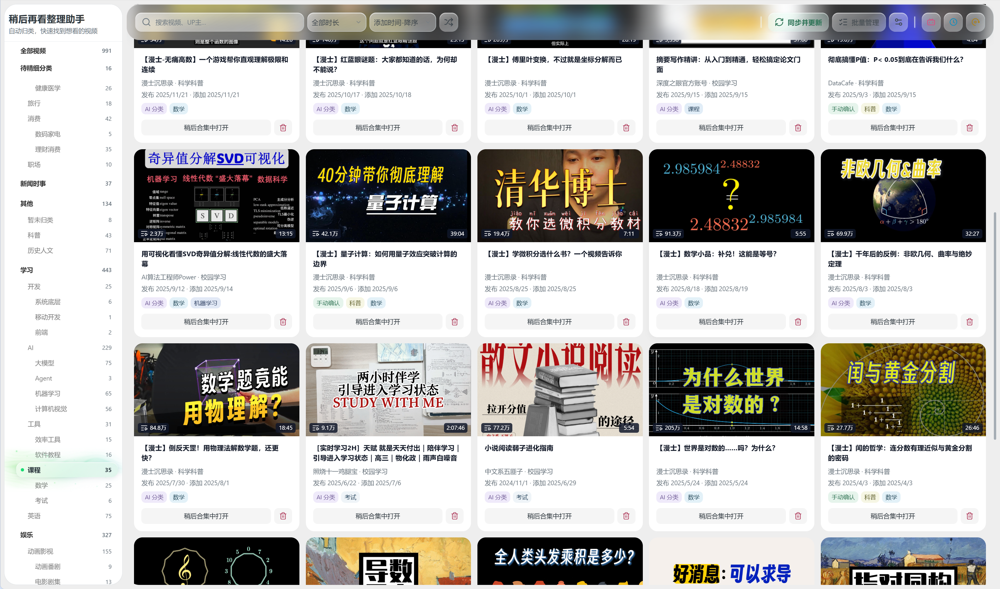

# 稍后再看整理助手

当前版本：1.4.0

自动整理 B 站稍后再看列表，按分类、时长和观看进度找到想看的视频。插件会先在本地做初步分类，也可以使用 AI 批量整理，或手动确认重要视频。

## 安装与更新

Edge 用户可在 Microsoft Edge 插件商店搜索 **稍后再看整理助手**。商店版与 GitHub Release 的版本可能不同。

### 从 GitHub 安装

1. 从 [GitHub Releases](https://github.com/Luo-YaFei/bilibili-watch-later-organizer/releases) 下载 `bili-watchlater-organizer-edge-*.zip` 并解压。
2. 在 Chrome 打开 `chrome://extensions/`，或在 Edge 打开 `edge://extensions/`，开启开发者模式。
3. 点击「加载已解压的扩展程序」，选择直接包含 `manifest.json` 的文件夹。
4. 登录 B 站，点击浏览器工具栏中的插件图标，按引导同步列表并选择分类目录。

### 更新已手动安装的版本

下载并解压新版 ZIP，用其中的文件覆盖当前扩展目录，再到扩展管理页点击「重新加载」。保留当前目录路径，浏览器才能继续加载原来的扩展。

## 浏览与整理

- **浏览和筛选**。从左侧切换分类，用顶栏搜索、按时长或播放进度筛选，也可以排序或乱序。「设置 → 浏览设置」可以指定默认打开的分类、筛选、排序及每批加载数量。
- **打开和找回视频**。点击封面打开普通视频页，或点击「稍后合集中打开」。右下角可以回到顶部或定位到上一次打开的视频。
- **调整分类**。点击视频卡片的文字区域，查看已保存的视频详情并选择分类，然后点击「保存为手动确认」。
- **同步或移出视频**。点击「同步并更新」获取最新列表和缺失信息。点击卡片上的移出图标后，插件会向 B 站确认操作，失败时自动恢复卡片。
- **显示评论 IP 属地**。在「设置 → 小工具」开启「显示评论 IP 属地」。B 站提供属地时会显示在视频页的评论时间旁。该功能默认关闭。

### 分类目录与视频分类

「编辑分类目录」用来决定有哪些分类以及它们的层级。你可以使用默认目录、手动编辑、让 AI 生成目录，或导入目录。

| 分类方式 | 含义 |
| --- | --- |
| 初步分类 | 插件根据标题、分区等信息在本地快速归类，无需配置 API。 |
| AI 分类 | 通过 API 或手动导入 AI 生成的结果，进一步整理视频。 |
| 手动确认 | 由你保存，优先级最高，自动分类会跳过。 |

「待精细分类」集中显示只有初步分类、结果过旧、结果不确定或分类异常的视频。「其他 / 暂未归类」是没有合适归属时可用的目录分类。

## 批量管理

### 手动批量调整

1. 点击顶栏的「批量管理」。
2. 单击卡片或拖拽框选视频，也可「全选当前结果」。
3. 勾选分类并点击「添加所选分类到视频」。也可用「清除选中视频中所有现有分类」把所选视频放回待精细分类。

### AI 批量视频分类

- **使用 API 自动分类**。在「设置 → AI 服务」保存 OpenAI-compatible 或 Jev（TypeSafe）连接，进入「视频分类 API」选择服务并保存。然后在「AI 批量视频分类」中设置数量并启动，也可从「待精细分类」点击「一键 AI 分类」处理全部待精细分类视频。
- **手动复制 Prompt**。在「设置 → AI 批量视频分类」生成 Prompt，交给 ChatGPT、Gemini 等 AI，再将返回的 JSON 粘贴回插件导入。
- **自动触发**。可设置每天、每周或待精细分类达到指定数量时运行。浏览器需保持运行。自动分类会跳过手动确认的视频。

#### 使用 Jev 分类视频

1. 在「设置 → AI 服务 → Jev」填写 TypeSafe API Key，模型默认为 `jev-latest`。测试连接后点击「保存连接」。
2. 在「视频分类 API」选择 Jev（TypeSafe）并保存。
3. 打开「AI 批量视频分类」填写数量并启动。

Jev 从现有目录中为每个视频选择一个类别，每批最多处理 5 个视频，支持最多 255 个启用的分类。结果不确定的视频仍可在「待精细分类」中查看。分类目录生成使用单独保存的 OpenAI-compatible 连接。[TypeSafe 接口说明](https://docs.typesafe.ai/api)

## 数据与隐私

视频信息、分类、设置和 API Key 保存在扩展本地。保存过的封面可离线显示。初步分类在本地运行，使用 AI API 分类或开启自动分类时，所选服务会收到分类所需的视频文本和分类目录。卸载扩展通常会同时删除本地数据。[隐私政策](PRIVACY.md)

本项目与哔哩哔哩官方无关。同步失败时可先确认浏览器仍登录 B 站。AI 分类失败时可检查连接配置、余额和 JSON 输出选项。

## 更新记录

### v1.4.0

- **浏览与分类**。新增返回顶部和定位上一次打开的视频。可设置默认分类、筛选、排序和每批加载数量。「部分播放」包含看过一部分和已经看完的视频。待精细分类支持一键 AI 分类，OpenAI-compatible 与 Jev 可分别配置和测试。
- **同步与性能**。大列表分批显示，搜索、筛选和全选覆盖完整结果。同步保留已显示的卡片和封面，详情分批补齐。封面保存到浏览器本地，支持离线查看，快速滚动后返回时减少闪烁。页面静置时暂停装饰动画。
- **界面与交互**。统一磨砂玻璃按钮、弹窗和操作反馈。宽屏最多显示六列，同排视频完整标题、UP 主和分类标签对齐。优化手动分类、批量管理和目录编辑面板，目录支持拖动调整三级层级。
- **评论小工具**。在「设置 → 小工具」开启「显示评论 IP 属地」，即可在视频页评论时间旁看到 B 站已提供的属地。默认关闭。

升级保留已有分类目录和手动确认结果。AI 分类仍由用户启动或按已启用的自动触发设置运行。

### v1.3.0

- 更新浅灰背景、贴边封面和白色圆角卡片，分类侧栏支持循环滚动和选中光效。
- 顶栏集中搜索、同步、批量管理和 B 站入口。分类、搜索、乱序和移出视频加入平滑过渡，支持系统的减少动态效果设置。
- 操作反馈会自动消失，完整记录可在本机操作日志中查看。
